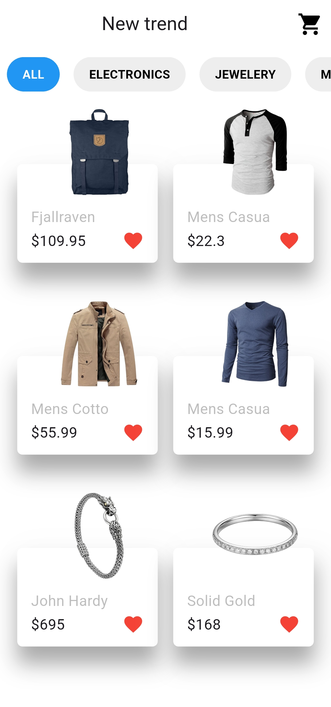
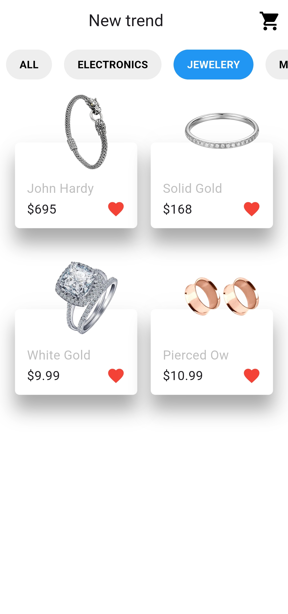
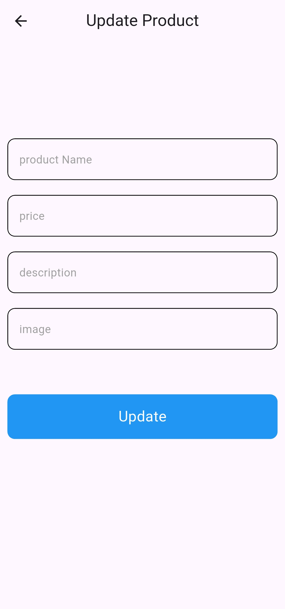

# Store App

A Flutter store app that loads products from a REST API. Browse the products, filter them by category, and edit a product's details.

The app uses [Fake Store API](https://fakestoreapi.com) as its backend.

## Features

- **Product catalog:** products are loaded from the API and shown in a grid with an image, a short title, and the price.
- **Category filter:** a horizontal list of categories lets you show all products or only one category.
- **Edit a product:** tap a product to open the edit screen, change its name, price, description or image, and send the update to the API.
- **Loading and error feedback:** a loading overlay while requests are running, and a message when something goes wrong.

> Fake Store API accepts update requests but does not save them, so edited values will not appear after reloading the products.

## Screenshots


<--    -->

## Tech stack

| Area | Tools |
| --- | --- |
| Framework | Flutter, Dart |
| State management | `flutter_bloc` (Cubit) |
| Networking | `http` (GET, POST, PUT) |
| UI | `modal_progress_hud_nsn` |

## Project structure

```
lib/
├── cubits/     # State management (home page, update page)
├── services/   # API calls (products, categories, add, update)
├── models/     # Product and rating models
├── helper/     # API helper, snack bar, custom button and text field
├── screens/    # Home page and update product page
├── widget/     # Product card
└── main.dart
```

## Getting started

1. Install [Flutter](https://docs.flutter.dev/get-started/install).
2. Clone the repository:
   ```bash
   git clone https://github.com/ZAIN-Zaug/store-app.git
   cd store-app
   ```
3. Install the dependencies:
   ```bash
   flutter pub get
   ```
4. Run the app:
   ```bash
   flutter run
   ```

## Author

**Zain Ahmad Issa** — [GitHub](https://github.com/ZAIN-Zaug)
